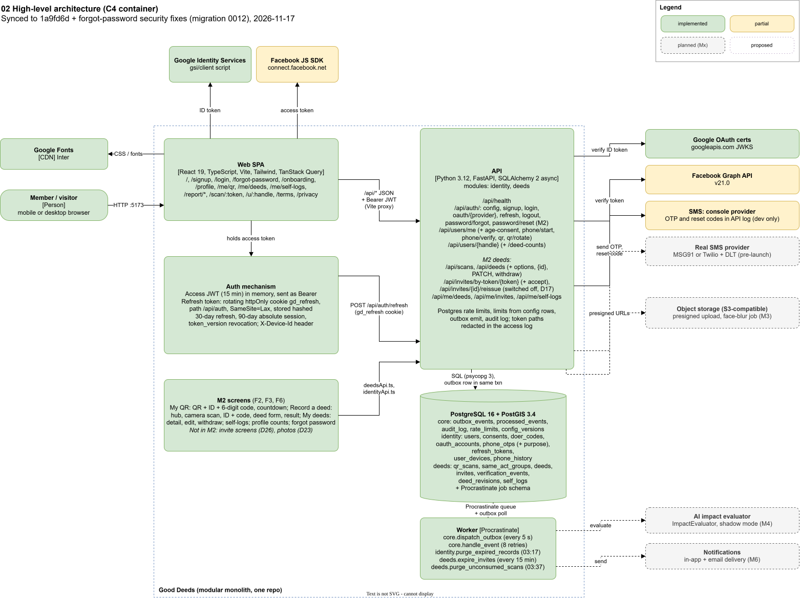
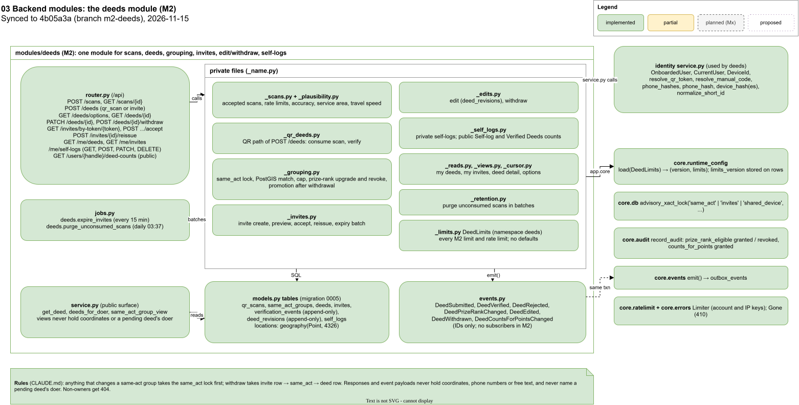
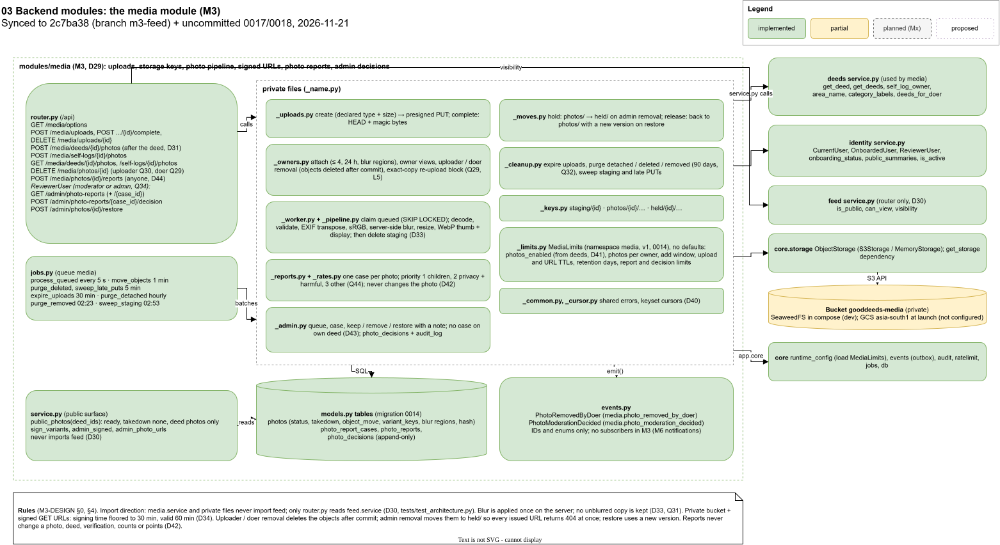
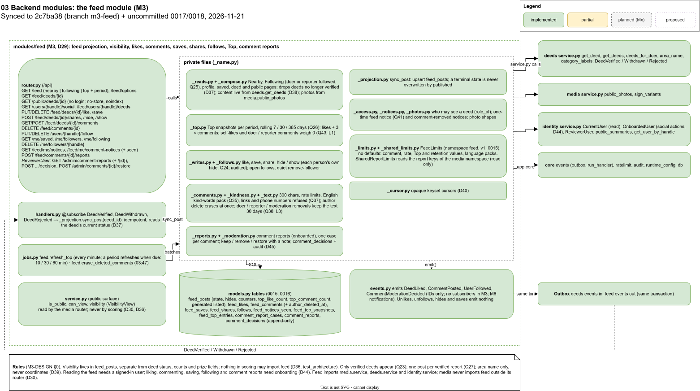
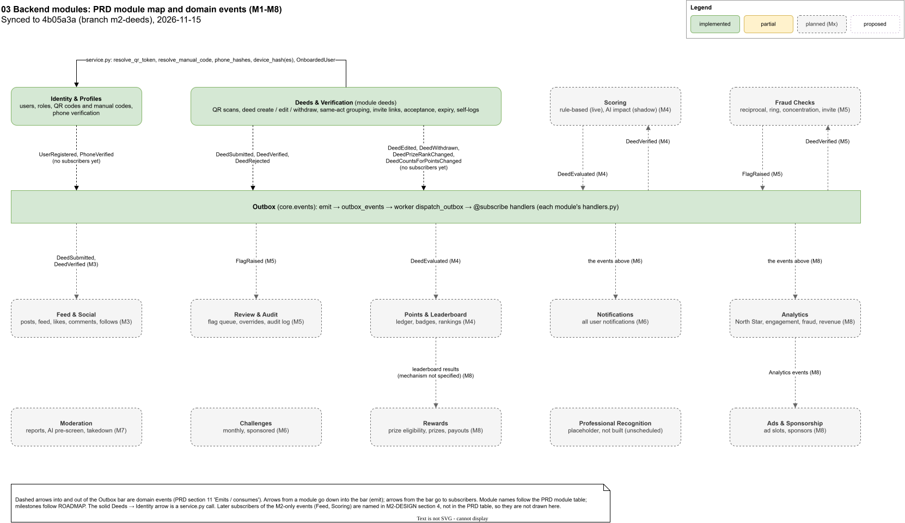
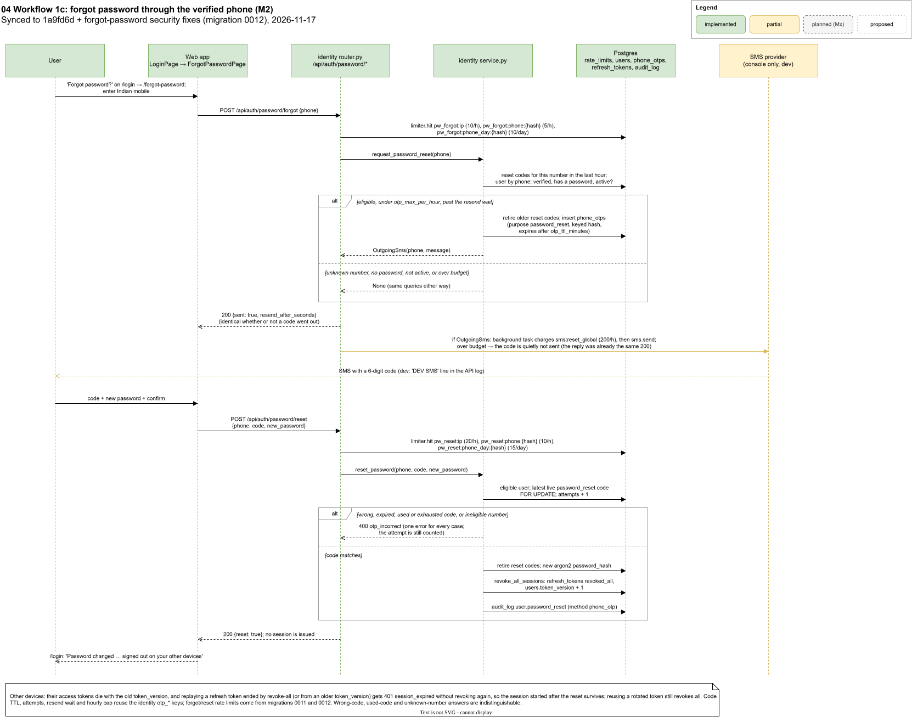
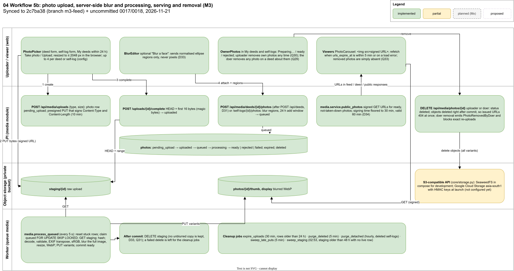
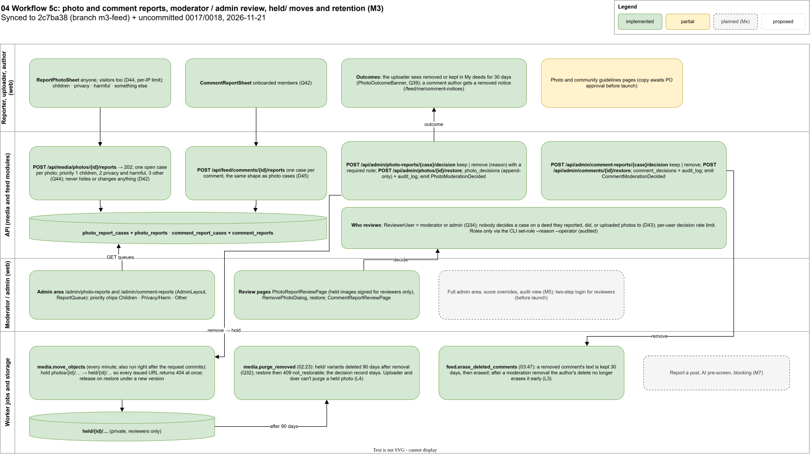

# Good Deeds architecture diagrams

**Synced to commit `2c7ba38` (`m3-feed`) plus the uncommitted working tree (migrations `0017_real_ward_areas` and `0018_deeds_v6`, the 127.0.0.1 storage endpoint) on 2026-11-21.** The implemented baseline is M0 + M1 + M2 + M3 (feed and social, photos, photo and comment reports with a moderator/admin review queue, the public share page), backend and screens. M3 is built, QA'd and security-reviewed but **not yet approved by the PO**. M4–M8 are not built. Pages changed for M3 say "Synced to 2c7ba38 (branch m3-feed) + uncommitted 0017/0018"; unchanged pages keep their older sync line.

What AD3 changed since `c294451` (M3, [M3-DESIGN](../M3-DESIGN.md) Revision 2 and the code):
- **Two new modules (D29):** `media` (uploads, the photo pipeline, signed URLs, photo reports, admin decisions) and `feed` (the feed projection, visibility, likes, comments, saves, shares, follows, Top, comment reports). Each has its own page in 03.
- **Storage (D35):** `app/core/storage.py` talks to any S3-compatible store. SeaweedFS runs in docker-compose (`storage`, plus a one-shot `storage-init` that creates the bucket and its CORS rules); Google Cloud Storage `asia-south1` is the launch target but isn't configured, so storage is drawn as partial.
- **Photo pipeline (D31–D34):** presigned PUT straight to `staging/`, `complete` checks the object, attach after the deed with blur regions, the worker blurs on the server, writes WebP variants under `photos/` and deletes the raw upload. Viewers get signed GET URLs (signing time floored to 30 min, valid 60 min). Admin removal moves variants to `held/` (90 days, Q32); uploader and doer removals delete the objects at once.
- **Reports and review (D42–D45):** photo reports (anyone) and comment reports (onboarded members) open cases; moderators and admins decide keep / remove / restore with a note, in two queues under `/admin`. Roles change only through `python -m app.modules.identity.cli set-role HANDLE ROLE --reason ... --operator ...` (audited).
- **Feed (D36–D40):** handlers for `DeedVerified`, `DeedWithdrawn` and `DeedRejected` call one idempotent `sync_post`; every read re-checks the deed live. Top snapshots per period (week, month, year) with zero weight for self-likes and for the doer's and reporter's own comments (Q43, L1). Public share page `/d/:id` with `no-store` and `noindex` (Q40).
- **Migrations 0013–0018:** `areas` + `deeds.area_id` + `deeds` v5; media tables + `media` v1; feed tables + `feed` v1 + backfill; `feed_posts.top_comment_count` (L1) and `feed_comments.author_deleted_at` (L3); 0017 re-seeds `areas` with the 369 GBA wards; 0018 publishes `deeds` v6 (the report-limit warning thresholds).
- **New jobs:** nine `media.*` jobs on the `media` queue and two `feed.*` jobs (see 02 and 03).
- **Area names are implemented:** migration 0017 re-seeds `areas` with the 369 GBA wards (display names from `ward_candidate/names.csv`) and recomputes `deeds.area_id` (discrepancy 20, resolved).

These diagrams are drawn from the repository (code, migrations, `docker-compose.yml`, CI, PRD and ROADMAP), not from assumptions. Every shape stores its evidence: open a diagram, select a shape, and choose **Edit → Edit Data** to see its `status`, `milestone`, `source` (repo paths) and `details`.

## How to open

The `.drawio` files open in [app.diagrams.net](https://app.diagrams.net) (File → Open from → Device), in draw.io Desktop, or in VS Code with the "Draw.io Integration" extension. They are saved as uncompressed XML, so Git diffs are readable. Opening a `.drawio` file in a text editor or on GitHub shows that XML, not the picture. The images below are SVG exports in `img/`, one per page, made with draw.io Desktop. Re-export them whenever a `.drawio` file changes.

## Legend

| Status | Style | Meaning |
|---|---|---|
| IMPLEMENTED | solid border, green fill | Code on the branch, wired in (registered module, mounted route, migrated table, compose service, CI job). |
| PARTIAL | solid border, amber fill | Code exists but is disabled, unconfigured or dev-only. |
| PLANNED (Mx) | dashed border, grey fill | In ROADMAP or PRD, no code yet. Label ends with the milestone. |
| PROPOSED | dotted border, white fill | From a design the product owner hasn't approved yet (none at the moment: M3 is built from the approved M3 design). |

## Diagrams

### 01 System context: [`01-system-context.drawio`](01-system-context.drawio)

Good Deeds as one system with its people and external services. M1 covers accounts, phone OTP, the age and consent gate, profiles and the rotating doer QR. M2 adds password reset by SMS code and recording, verifying, editing and withdrawing deeds. M3 adds the feed, photos, social actions, shares, the public share page and report review.
- **Witness / reporter** and **doer** are unchanged; the doer now also removes photos on deeds about them and hides deeds from the feed.
- **Viewer / member** is now implemented (M3): reads the feed, likes, comments, saves, follows, shares and reports. Visitors without an account see only `/d/:id` and public profiles.
- **Moderator / admin** is implemented for M3's report review only; overrides and flags stay M5.
- **External services:** Google sign-in works once configured; Facebook and SMS are partial. **Object storage** is partial (SeaweedFS locally, GCS not configured). **WhatsApp / Web Share** is implemented (share sheet, generic link preview).
- **Planned:** sponsors (M6/M8), organisations (unscheduled), AI (M4), email (M6), CAPTCHA (before launch).

### 02 High-level architecture: [`02-high-level-architecture.drawio`](02-high-level-architecture.drawio)

- **Frontend:** the React SPA calls the API through the Vite `/api` proxy, with the 15-minute access JWT in memory and the rotating `gd_refresh` cookie. A new **M3 screens** box covers the feed, deed page, share sheet, public page `/d/:id`, profiles with follows, saved, the photo picker and blur editor, report sheets and the admin queues. The browser PUTs photo uploads and loads images **straight from storage** with signed URLs (dashed arrow).
- **API:** modules `identity`, `deeds`, `media`, `feed`. The box lists the `/api/media/*`, `/api/feed/*`, `/api/public/deeds/{id}` and `/api/admin/*` routes.
- **Database:** 37 application tables, head `0018`; the box names the media and feed tables and cites every migration.
- **Worker:** one Procrastinate worker on all queues. It adds `media.process_queued` (every 5 s), `media.move_objects` (1 min), `media.purge_deleted` and `media.sweep_late_puts` (5 min), `media.expire_uploads` (30 min), `media.purge_detached` (hourly), `media.purge_removed` (02:23), `media.sweep_staging` (02:53), `feed.refresh_top` (every minute, each period when due) and `feed.erase_deleted_comments` (03:47), plus the feed's three event handlers.
- **Object storage** is partial: SeaweedFS in compose works; GCS `asia-south1` with HMAC keys is the launch target and has no configuration yet.
- **Planned:** AI evaluation (M4) and notifications (M6).

### 03 Backend modules: [`03-backend-modules.drawio`](03-backend-modules.drawio)
Five pages.

- **Core + identity:** `registry.py` now lists `identity`, `deeds`, `media`, `feed`. Core gains **`storage`** (the `ObjectStorage` protocol, `S3Storage` over boto3 with SigV4, `MemoryStorage` for tests) and `db` creates its engine with `hide_parameters`. Identity's `service.py` adds `ReviewerUser` (moderator or admin), `onboarding_status`, `get_user_by_handle` and `set_role`; the new `cli.py` is the only way to change a role, writes `audit_log` (`role.changed`, with reason and operator) and bumps `token_version`.

- **Deeds module:** M3 adds `_areas.py` (area at create and accept, nearest area within 1500 m, else "Bangalore"; the seed holds the 369 GBA wards since 0017), the `areas` table and `deeds.area_id` (0013, re-seeded by 0017), `deeds` v5 (`photos_enabled` moved to `media`, `area_fallback_m`) and v6 (0018: `reporter_monthly_warn_at` 10, `reporter_doer_monthly_warn_at` 3), and `service.py` functions `get_deeds`, `area_name`, `category_labels`, `self_log_owner`. The feed now subscribes to `DeedVerified`, `DeedWithdrawn` and `DeedRejected`.

- **Media module (new):** the router (uploads, attach, owner views, removal, photo reports, admin queue and decisions), nine jobs on the `media` queue, the private files (`_uploads`, `_owners`, `_worker` + `_pipeline`, `_reports`, `_admin`, `_moves`, `_cleanup`, `_keys`, `_limits`), four tables (0014, `photo_decisions` append-only) and two events with no subscribers yet. Imports go to `deeds.service`, `identity.service` and `app.core`; only `router.py` reads `feed.service` (D30).

- **Feed module (new):** the router (feed tabs, deed and public pages, social actions, hide/show, follows, notices, comment reports, comment review), the three handlers and `sync_post`, two jobs, the private files (`_reads` + `_compose`, `_top`, `_writes` + `_follows`, `_comments` + `_kindness`, `_reports` + `_moderation`, `_limits` + `_shared_limits`), twelve tables (0015, 0016) and four events with no subscribers yet.

- **Module map (M1–M8):** Feed & Social is implemented and consumes `DeedVerified`, `DeedWithdrawn`, `DeedRejected`; a new **Media** box (M3-DESIGN D29, not in the PRD table) emits `PhotoRemovedByDoer` and `PhotoModerationDecided`; Feed emits `DeedLiked`, `CommentPosted`, `UserFollowed`, `CommentModerationDecided`. Moderation (M7) notes that photo and comment reports moved into M3.

### 04 Workflows: [`04-workflows.drawio`](04-workflows.drawio), ten pages
1. **1a Google sign-in** (implemented, sequence diagram; unchanged since AD1):
   - `/auth/config` decides whether the button shows.
   - Google's popup returns an ID token, and `POST /auth/oauth/google` verifies it against Google's keys (audience, issuer, 30 s clock leeway).
   - An `alt` frame shows the three outcomes: the existing linked user, a 409 `email_exists` (never an automatic link), or a new user. Then the session starts with the refresh cookie.

   
2. **1b Onboarding gate and password sign-up** (implemented):
   - Password sign-up records age (18+) and consent in the same request; Google users do the age and consent step instead.
   - Both paths then verify an Indian mobile by OTP through the dev-only console SMS provider. That writes `phone_history` and unlocks My QR.
   - Phone verification accepts only codes whose purpose is `phone_verify`, and `phone/start`'s hourly caps count only those codes. A note points to page 1c.

   
3. **1c Forgot password** (new page; implemented, sequence diagram):
   - **Request a code:** `/login` → `/forgot-password` → `POST /api/auth/password/forgot`.
     - Rate limits per IP (10/h) and per phone hash (5/h and 10/day).
     - `request_password_reset` issues a code only for an active account with a verified phone and a password, under the hourly cap and resend wait. It retires older codes and stores the new one with purpose `password_reset`.
     - The response is always `{sent: true, resend_after_seconds}`. The SMS goes out as a background task after the response, which first charges `sms:reset_global` (200/h) and quietly skips the SMS when that budget is spent, so the reply never reveals whether an account exists.
   - **Reset:** `POST /api/auth/password/reset` (per IP 20/h; per phone 10/h and 15/day) locks the latest live code and counts the attempt.
     - Every failure is the same 400 `otp_incorrect`.
     - On success it sets the new argon2 hash, revokes all refresh tokens, bumps `token_version` and writes `audit_log` (`user.password_reset`).
     - No session is issued; the user signs in again. Replaying an old refresh token from another device gets 401 `session_expired` without ending the new session.

   
4. **2 QR identity and scanning** (implemented):
   - **My QR (F2):** the QR, the ID, the 6-digit code and a countdown bar sized by `window_seconds`.
   - **Witness paths:** the phone camera opens `/scan/:token`, which moves the token into memory and replaces the URL with `/report/link`. The in-app camera is `/report/scan`, and typed ID + code is `/report/code`.
   - **`POST /api/scans` order:**
     1. Rate limits, including 20 per 15 min and 60 per day per typed ID.
     2. The monthly-total pre-check.
     3. Resolve the code.
     4. Self and shared-phone checks.
     5. Pair checks: 409 `already_recognized_today` or 429 `pair_monthly_limit`, both naming the doer (D27).
     6. Plausibility.
     7. Response: `scanned_at`, `pair_reports_remaining` and `month_resets_at`.
   - A box shows the access-log redaction of `/scan/{token}`.

   
5. **3 Deed reporting and verification** (QR path implemented; invite path partial):
   - **Reporter screens:** the hub's LimitBanner, the deed form and the result screen are implemented.
   - **QR path:** `POST /api/deeds` reads the scan's doer without a lock, then takes `reporter_month` and checks the total (150) and the pair (15) before consuming the scan. Grouping uses the scan's `scanned_at` (D28).
   - **Invite path:** built but switched off by config (403 `invites_disabled`), so it is drawn partial.
     - Create checks only the total.
     - Accept takes `reporter_month` → invite row → `shared_device` → pending deed → `same_act`. A suspended reporter gets 404 `invite_invalid`, and the pair limit applies in the month of `reported_at`.
     - Grouping uses `reported_at`.
     - The invite screens (F4, F5) are unscheduled (D26). The expiry job still runs.

   
6. **3b Edit and withdraw** (implemented):
   - **My deeds (F6):** Reported / Recognised tabs, `DeedDetailPage`, `EditDeedPage` and `WithdrawDeedDialog` call the edit and withdraw endpoints.
   - **Edit:** writes a `deed_revisions` row and emits `DeedEdited`.
   - **Withdraw:** locks the invite row → `same_act` → deed row.
     - A pending deed cancels its invite. A verified deed leaves its group, with promotion and prize-rank revocation.
     - The deed still counts toward the monthly limits.
   - **The doer's view (D24):** a withdrawn report disappears; the reporter still sees it as Withdrawn.
   - **M3:** the feed consumes `DeedWithdrawn` (the post becomes withdrawn, and reads drop it at once); edits need no handler because the feed reads content live (D38). Scoring (M4) is still planned.

   
7. **4 Impact scoring** (M4, planned; unchanged):
   - Rule-based points with a shadow AI evaluator that never affects points.
   - An append-only ledger with caps, plus rank score, tier and badges.

   
8. **5 Feed publishing and reads** (M3, implemented; replaces the planned page):
   - The three deed events reach the feed handlers through the outbox; `sync_post` upserts `feed_posts`.
   - `GET /api/feed` (Nearby, Following, Top with week / month / year) and the deed page read posts, re-check each deed live, read content from `deeds.get_deeds` and photos from `media.public_photos`.
   - Social writes keep the counters on `feed_posts`; hide / show is per person (Q24). `feed.refresh_top` snapshots Top; `feed.erase_deleted_comments` erases removed comment text after 30 days.
   - The public share page `/d/:id` calls `GET /api/public/deeds/{id}` (no login, `no-store`, `noindex`, per-IP limit). Ad slots stay M8. Area names come from the 369 GBA wards (0017).

   
9. **5b Photo upload and processing** (M3, new page, implemented):
   - Create upload → PUT bytes to `staging/` with a signed URL → `complete` (HEAD + magic bytes) → attach after the deed with blur regions (D31).
   - `media.process_queued` claims queued rows, blurs and resizes on the server, writes WebP variants under `photos/`, then deletes the staging object (no unblurred copy, D33).
   - Viewers load signed GET URLs; uploader and doer removals delete the objects right after commit. Cleanup jobs expire, purge and sweep. The bucket is partial (SeaweedFS only).

   
10. **5c Photo and comment reports, moderation** (M3, new page, implemented):
    - Photo reports (anyone, per-IP limit) and comment reports (onboarded members) open one case per item, with priorities children → privacy and harmful → other (Q44). Reports never change anything by themselves (D42).
    - Moderators and admins work two queues under `/admin` and decide keep / remove / restore with a note; nobody decides a case on their own deed (D43). Decisions go to append-only tables and `audit_log` and emit events with no subscribers yet.
    - An admin removal moves the variants to `held/` (`media.move_objects`); `media.purge_removed` deletes them after 90 days (Q32); uploader and doer can't purge a held photo (L4). Removed comment text is kept 30 days (L3). Guidelines pages are partial (copy awaits PO approval); the full admin area (M5) and post reports (M7) are planned.

   

### 05 Infrastructure and deployment: [`05-infrastructure-deployment.drawio`](05-infrastructure-deployment.drawio), two pages

- **Local Docker Compose** (synced to `2c7ba38`):
  - **Services:** `db` (PostGIS on `127.0.0.1:5432`, `db-data`), a one-shot `migrate` (head **0018**), `api` and `worker` (both built from `./backend`), `web` (Vite), and since M3 **`storage`** (SeaweedFS `chrislusf/seaweedfs:4.48`, S3 on `127.0.0.1:8333`, keys from `infra/seaweedfs/s3.json`, volume `storage-data`) and the one-shot **`storage-init`** (`amazon/aws-cli`, creates bucket `gooddeeds-media` and puts its CORS rules for `http://localhost:5173`).
  - `api` and `worker` now also wait for `storage-init`. The `&backend-env` anchor adds the `GD_STORAGE_*` settings: the API and worker call `storage:8333`; URLs signed for browsers use `127.0.0.1:8333` (the port is published on IPv4 loopback only, and `localhost` can resolve to `::1` first). Dev keys are refused outside development.
  - The phone path through the cloudflared quick tunnel is unchanged (partial, dev only).

  
- **CI and deployment:** unchanged; CI and the Dockerfiles haven't changed since `c6395cf`, so this page still says "Synced to c6395cf".
  - GitHub Actions runs on pushes to `main` and on pull requests.
  - A backend job runs ruff, mypy and pytest against PostGIS. A frontend job runs lint, format, typecheck, test and build.
  - No deployment config exists, so CD and production hosting are planned, unscheduled.

  

## Discrepancies found while drawing

First found on 2026-11-12; re-checked on 2026-11-15 against `4b05a3a` on 2026-11-17 against `1a9fd6d` and on 2026-11-21 against `2c7ba38`. These are inconsistencies between code, PRD, ROADMAP and `CLAUDE.md`; none were fixed as part of the diagram work. The numbers stay the same between updates.

1. **Facebook can't be enabled under Docker.** Compose forwards only `GD_GOOGLE_CLIENT_ID`; the Facebook settings and `GD_SMS_PROVIDER` never reach the containers. ROADMAP marks Facebook in M1 as done. *Still open.*
2. **The audit log is never written.** *Mostly resolved* (see [M2-DESIGN §0](../M2-DESIGN.md#0-decisions-on-known-discrepancies)):
   - `audit_log` is written by `runtime_config.publish`, by the deeds module (prize-rank grants and revokes, promotions after a withdrawal) and, since `1a9fd6d`, by the identity password reset (`user.password_reset`).
   - Deed status changes go to the append-only `verification_events` table instead.
   - *Still open:* QR reset, phone verification and revoke-all sessions are not audited.
3. **Scanning a QR today goes nowhere.** *Resolved:* `POST /api/scans` resolves tokens and codes (M2 backend). Since `1a9fd6d`, `/scan/:token` is `ScanLandingPage`, which moves the token into memory and continues the report flow. The M1 placeholder `features/scan/ScanPage.tsx` was deleted.
4. **QR tokens are accepted for up to about 90 s.** *Resolved by M2* (see [M2-DESIGN §0](../M2-DESIGN.md#0-decisions-on-known-discrepancies)): the window and grace moved from env settings to the `qr` config namespace, seeded as `window_seconds=30` and `grace_windows=1` (migration 0004). A token or manual code is now accepted for 30–60 s.
5. **The architecture test is weaker than `CLAUDE.md` says.** It checks only absolute imports, so relative imports get past it. It also cannot enforce "side effects only through events". *Still open* (`tests/test_architecture.py` is unchanged).
6. **Event names disagree.** *Resolved by M2* (see [M2-DESIGN §0 and §4](../M2-DESIGN.md#4-events-backendappmodulesdeedseventspy)):
   - The code, PRD §11 and ROADMAP M2 now list the same seven deeds events: `DeedSubmitted`, `DeedVerified`, `DeedRejected`, `DeedEdited`, `DeedWithdrawn`, `DeedPrizeRankChanged` and `DeedCountsForPointsChanged`.
   - The proposed `DeedUnverified` was dropped. Invite expiry is `DeedRejected(new_status="unverified", reason="invite_expired")`.
   - PRD §11 now says Identity emits `UserRegistered` and `PhoneVerified`. None of these events has a subscriber yet.
7. **Self-logs are placed in different modules.** *Resolved by M2* (see [M2-DESIGN §0, D3 and D4](../M2-DESIGN.md#01-product-owner-decisions-2026-11-15)): self-logs live in the `deeds` module, and PRD §11 now puts them under "Deeds & Verification".
8. **Object storage:** *Resolved by M3:* SeaweedFS replaces MinIO in docker-compose (D35), and PRD §14 now says GCS at launch and SeaweedFS locally.
9. **No deployment path.** *Still open.*
   - Compose runs dev servers (`uvicorn --reload`, Vite).
   - CI builds no images.
   - ROADMAP has no deployment milestone.
10. **Feature branches aren't CI-checked** until a pull request is opened, because CI runs only on `main` and on PRs. *Still open.*
11. **The PRD places AuditLog in M5** (Review & Audit), but `audit_log` has existed in core since M0 and has been written since M2. *Still open.*
12. **Organisations** appear only as future work in the PRD and not in the ROADMAP. *Still open.*
13. **Later subscribers of the M2 events.** *Partly resolved by M3:* the feed subscribes to `DeedVerified`, `DeedWithdrawn` and `DeedRejected` (M3-DESIGN §5). PRD §11's Feed row still says it consumes `DeedSubmitted, DeedVerified`, which the code doesn't do. Scoring's (M4) subscribers remain design-only. *Still open.*
14. **ROADMAP M2 says invite acceptance means "sign up through the link".** D9 and PRD §5 let existing members accept too, and the code allows it. Invites are now switched off and have no screens (D17, D26). *Still open.*
15. **Naming only:** PRD §11 calls the module "Deeds & Verification"; the code module is `deeds`. The diagrams show both names. *Still open.*
16. **Forgot password was only in the ROADMAP.** *Resolved:* PRD §5 step 1 now describes it.
17. **`CLAUDE.md` missed parts of identity.** *Resolved:* it now covers the password reset, `phone_otps.purpose` and `is_active`.
18. **M2-DESIGN's status line.** *Resolved:* it says Revision 5 is approved, built and pushed.
19. **(Naming only) Migration numbering skips 0010:** `0011_identity_password_reset` revises `0009`. Alembic is fine with this; it's noted so nobody looks for a missing file.

20. **(New) Area names use placeholder data.** PO decision Q28 (2026-11-19, recorded in `deeds/data/ward_candidate/AREAS_SOURCE.md`) says to use the GBA ward dataset now, but migration 0013 seeded `deeds/data/bangalore_areas.geojson`, which holds 13 hand-made placeholder areas ("PLACEHOLDER - replace with the official ward dataset"). Most real deeds will show "Bangalore" or a coarse placeholder name until the ward file replaces it (task DB4). *Resolved:* migration `0017_real_ward_areas` re-seeds the table with the 369 GBA wards in `bangalore_areas.geojson`; `_areas.py` and the area boxes are drawn as implemented (uncommitted at sync time).
21. **(New) The reporting-limit warning thresholds are code constants.** "Warn from 3 left for a pair and from 10 left in total" lives in `frontend/src/features/report/limits.ts` (`PAIR_WARN_AT`, `TOTAL_WARN_AT`), not in a config row, although `CLAUDE.md` says every tunable limit is config. PRD §12's limits table doesn't list them. *Resolved:* migration 0018 publishes them as `deeds` v6 (`reporter_doer_monthly_warn_at` 3, `reporter_monthly_warn_at` 10); `GET /api/deeds/options` returns them and the frontend uses those values.
22. **(New) M3-DESIGN §4.8's job table is incomplete.** The code also runs `media.process_queued` (every 5 s, the pipeline) and `media.sweep_late_puts` (every 5 min, SEC2 L7), and `feed.refresh_top` is one job every minute that refreshes each period when it is due (10 / 30 / 60 min). *Resolved:* the table now lists them.
23. **(New) M3-DESIGN's status line** still says "Nothing is built yet", although M3 is built in `5f37066`–`2c7ba38`. *Resolved:* it now says built, QA'd, security-reviewed and awaiting PO review.
24. **(New) PRD §11 has no Media module.** M3-DESIGN D29 adds a `media` module (uploads, pipeline, photo reports and decisions); the PRD module table and its Moderation row ("reports") don't mention it or that photo and comment reports moved into M3. *Resolved:* §11 has a Media row, Feed consumes `DeedVerified`, `DeedWithdrawn` and `DeedRejected`, and the Moderation row no longer lists photo and comment reports.

## Keeping this up to date

After each milestone's security review, the `architecture-diagram` agent compares the code against the synced commit above with `git diff`. It updates only the affected diagrams, promotes statuses as code lands, re-checks every shape's `source` path, renders every page to check the layout visually, re-exports the SVGs, and updates the synced commit. The watch table and the validation script are in the agent definition (`.claude/agents/architecture-diagram.md`).
