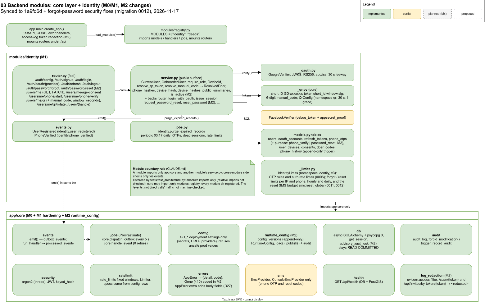
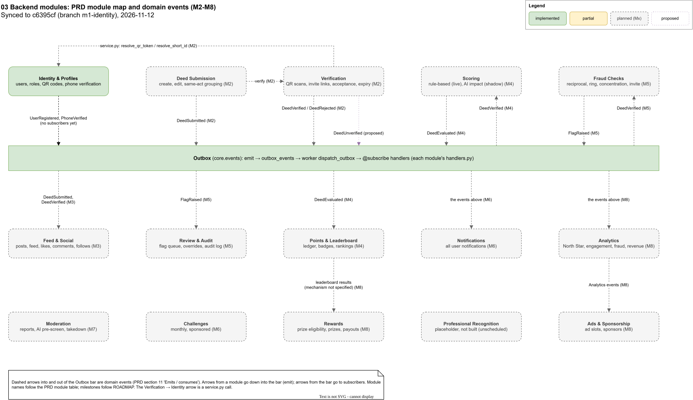
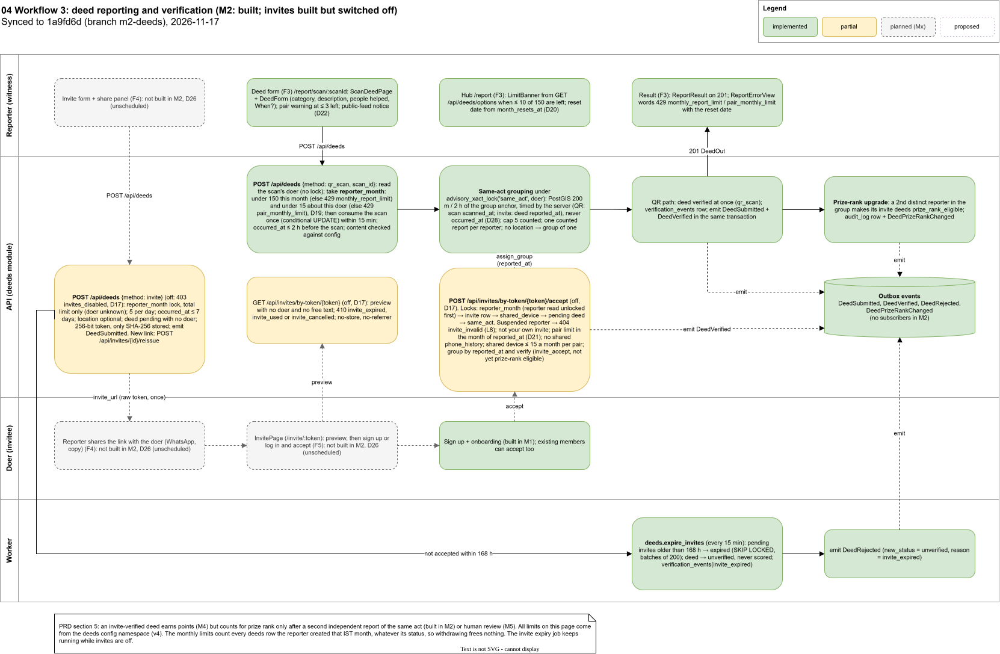
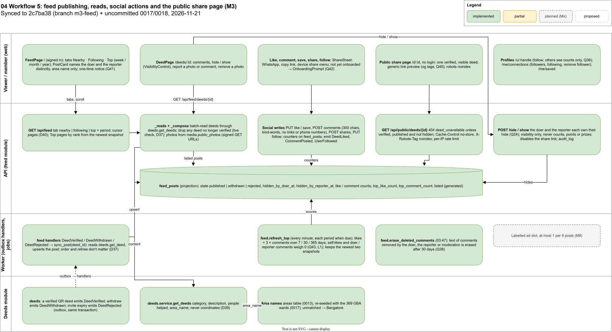

# Good Deeds architecture diagrams

**Synced to commit `c6395cf` (`m1-identity`) on 2026-11-12.** The implemented baseline is M0 + M1; M2–M8 are not built.

These diagrams are drawn from the repository (code, migrations, `docker-compose.yml`, CI, PRD and ROADMAP), not from assumptions. Every shape stores its evidence: open a diagram, select a shape, and choose **Edit → Edit Data** to see its `status`, `milestone`, `source` (repo paths) and `note`.

## How to open

The `.drawio` files open in [app.diagrams.net](https://app.diagrams.net) (File → Open from → Device), in draw.io Desktop, or in VS Code with the "Draw.io Integration" extension. They are saved as uncompressed XML, so Git diffs are readable. Opening a `.drawio` file in a text editor or on GitHub shows that XML, not the picture. The images below are SVG exports in `img/`, one per page, made with draw.io Desktop. Re-export them whenever a `.drawio` file changes.

## Legend

| Status | Style | Meaning |
|---|---|---|
| IMPLEMENTED | solid border, green fill | Code on the branch, wired in (registered module, mounted route, migrated table, compose service, CI job). |
| PARTIAL | solid border, amber fill | Code exists but is disabled, unconfigured or dev-only. |
| PLANNED (Mx) | dashed border, grey fill | In ROADMAP or PRD, no code yet. Label ends with the milestone. |
| PROPOSED | dotted border, white fill | From a design the product owner hasn't approved yet (currently the M2 design). |

## Diagrams

### 01 System context: [`01-system-context.drawio`](01-system-context.drawio)

Good Deeds as one system with its people and external services. Today (M0 + M1) it covers accounts, phone OTP, the age and consent gate, profiles and the rotating doer QR, so the **doer** is the only actor who can do their real job.
- **Planned actors:**
  - witnesses (M2)
  - viewers of the feed (M3)
  - admins and moderators (M5)
  - sponsors (M6/M8)
  - organisations (unscheduled; the PRD lists them as future only)
- **External services:** Google sign-in works once configured; Facebook sign-in and SMS are partial.
- **Planned external services:** storage, AI, email, CAPTCHA and WhatsApp sharing.

### 02 High-level architecture: [`02-high-level-architecture.drawio`](02-high-level-architecture.drawio)

- **Frontend:** the React SPA calls the FastAPI API through the Vite `/api` proxy. It holds a 15-minute access JWT in memory and refreshes it with a rotating httpOnly `gd_refresh` cookie scoped to `/api/auth`.
- **Backend:** the API and the Procrastinate worker share PostgreSQL 16 + PostGIS (12 application tables plus the job schema). Domain events go through a transactional outbox that the worker drains every 5 s.
- **Integrations:** Google sign-in is implemented when `GD_GOOGLE_CLIENT_ID` is set. Facebook is built but unconfigured, and SMS is console-only. Google and Facebook each appear twice: the browser-side SDK above the SPA, and the server-side token check to the right of the API.
- **Planned:** media storage (M3), AI evaluation (M4) and notifications (M6).

### 03 Backend modules: [`03-backend-modules.drawio`](03-backend-modules.drawio)

- **Core + identity:**
  - The `app/core` layer (config, db, events/outbox, jobs, audit, security, ratelimit, errors, sms, health) sits under the only registered module, `identity`.
  - `identity` is shown with its routes, its public `service.py` surface, its events (`UserRegistered`, `PhoneVerified`), its nightly retention job and its 8 tables.
  - A note gives the module boundary rule and what `tests/test_architecture.py` actually checks.
- **Planned module map (M2–M8):** every module from the PRD module table with its milestone, drawn as an event bus. Emitting modules sit above the Outbox bar and subscribing modules below it. Only the events the PRD or ROADMAP names are drawn.

### 04 Workflows: [`04-workflows.drawio`](04-workflows.drawio), six pages
1. **1a Google sign-in** (implemented, sequence diagram):
   - `/auth/config` decides whether the button shows.
   - Google's popup returns an ID token, and `POST /auth/oauth/google` verifies it against Google's keys (audience, issuer, 30 s clock leeway).
   - An `alt` frame shows the three outcomes: the existing linked user, a 409 `email_exists` (never an automatic link), or a new user. Then the session starts with the refresh cookie.

   
2. **1b Onboarding gate and password sign-up** (implemented):
   - Password sign-up records age (18+) and consent in the same request; Google users do the age and consent step instead.
   - Both paths then verify an Indian mobile by OTP through the dev-only console SMS provider. That writes `phone_history` and unlocks My QR.

   
3. **2 QR identity and scanning** (mixed):
   - **Implemented:** a signed token per 30 s window, the auto-refreshing My QR page, and Reset my QR.
   - **Partial:** the resolvers exist but have no caller, and `/scan/:token` is a placeholder page.
   - **Planned M2:** the scan endpoint.
   - **Proposed:** single-use scan records, the 6-digit rotating code, and the 60 s grace window.

   
4. **3 Deed reporting and verification** (M2, not built):
   - The QR path: scan, then submit, then same-act grouping, then verified.
   - The invite path: invite, then accept with a different phone, or the 7-day expiry.
   - The rules come from ROADMAP/PRD (planned). The endpoint shapes come from the unapproved M2 design (proposed).

   
5. **4 Impact scoring** (M4, planned):
   - Rule-based points with a shadow AI evaluator that never affects points.
   - An append-only ledger with caps, plus rank score, tier and badges.

   
6. **5 Feed publishing** (M3, planned):
   - Presigned media upload and a face-blur job.
   - Posts from deed events, with pending posts hiding the doer.
   - Nearby / Following / Top tabs, social actions, and M8 ad slots.

   

### 05 Infrastructure and deployment: [`05-infrastructure-deployment.drawio`](05-infrastructure-deployment.drawio), two pages
- **Local Docker Compose:** `db` (PostGIS, with a health check and the `db-data` volume), a one-shot `migrate`, then `api` and `worker` (both built from `./backend`) and `web` (the Vite dev server). The root `.env` supplies `GD_GOOGLE_CLIENT_ID` only. Each service's `depends_on` condition is written in its label rather than drawn as an arrow.

  
- **CI and deployment:** GitHub Actions runs on pushes to `main` and on pull requests, with a backend job (ruff, mypy, pytest against PostGIS) and a frontend job (lint, format, typecheck, test, build). No deployment config exists, so CD and production hosting are planned, unscheduled.

  

## Discrepancies found while drawing

Found on 2026-11-12. These are inconsistencies between code, PRD, ROADMAP and `CLAUDE.md`; none were fixed as part of the diagram work.

1. **Facebook can't be enabled under Docker.** Compose forwards only `GD_GOOGLE_CLIENT_ID`; the Facebook settings and `GD_SMS_PROVIDER` never reach the containers. ROADMAP marks Facebook in M1 as done.
2. **The audit log is never written.** `core.audit.record_audit` has no caller, so identity actions such as QR reset, phone verification and session revocation are not audited.
3. **Scanning a QR today goes nowhere.** `/scan/:token` is a placeholder page that ignores the token, and `resolve_qr_token` / `resolve_short_id` have no caller. This is expected until M2.
4. **QR tokens are accepted for up to about 90 s** (their own window plus 2 earlier ones). The proposed 60 s needs `qr_grace_windows=1`.
5. **The architecture test is weaker than `CLAUDE.md` says.** It checks only absolute imports, so relative imports get past it. It also cannot enforce "side effects only through events".
6. **Event names disagree.** The PRD says Verification emits `DeedVerified / DeedRejected`. ROADMAP lists `DeedSubmitted` and `DeedVerified`, and the M2 design adds `DeedUnverified`. The PRD also says Identity emits no events, but it emits `UserRegistered` and `PhoneVerified`, which nobody subscribes to yet.
7. **Self-logs are placed in different modules.** The PRD module table puts them in Identity; ROADMAP schedules them in M2; the M2 design puts them in the deeds module.
8. **Object storage:** PRD §14 says MinIO locally, but `CLAUDE.md` says the MinIO image is gone and a replacement will be chosen in M3.
9. **No deployment path.**
   - Compose runs dev servers (`uvicorn --reload`, Vite).
   - CI builds no images.
   - ROADMAP has no deployment milestone.
10. **Feature branches aren't CI-checked** until a pull request is opened, because CI runs only on `main` and on PRs.
11. **The PRD places AuditLog in M5** (Review & Audit), but `audit_log` has existed in core since M0.
12. **Organisations** appear only as future work in the PRD and not in the ROADMAP.

## Keeping this up to date

After each milestone's security review, the `architecture-diagram` agent compares the code against the synced commit above with `git diff`. It updates only the affected diagrams, promotes statuses as code lands, re-checks every shape's `source` path, renders every page to check the layout visually, re-exports the SVGs, and updates the synced commit. The watch table and the validation script are in the agent definition (`.claude/agents/architecture-diagram.md`).
