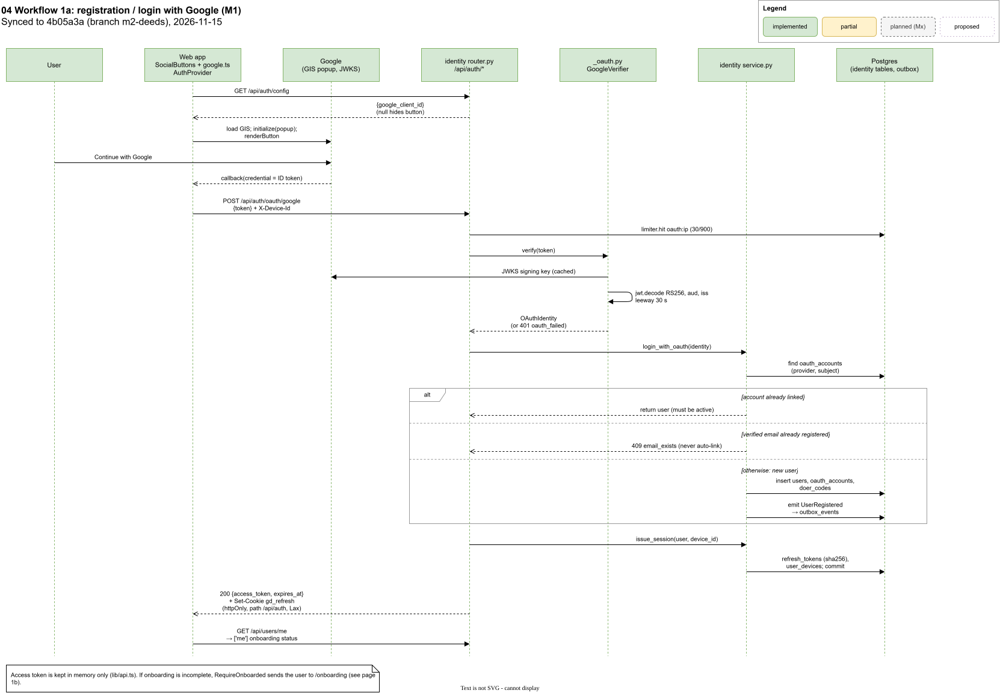
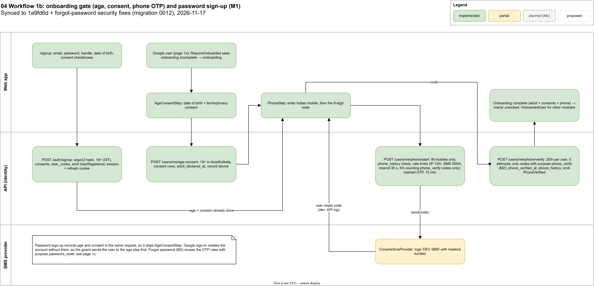
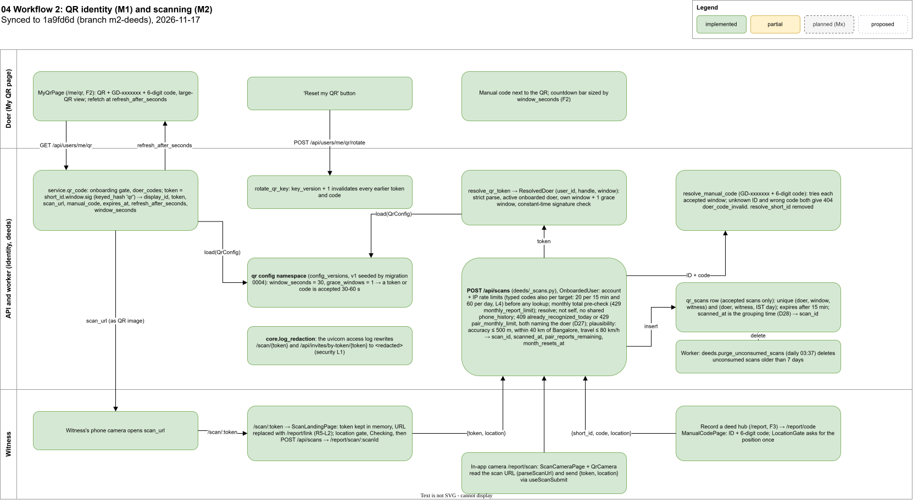
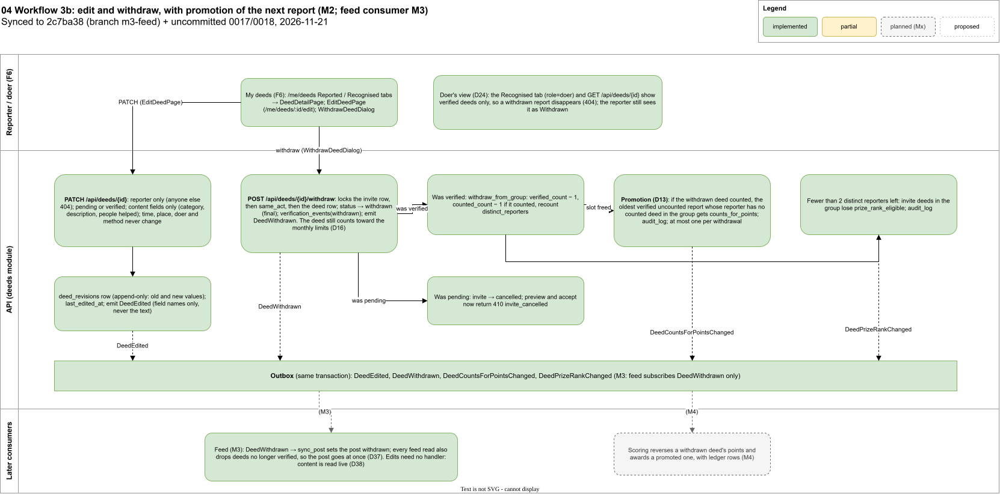
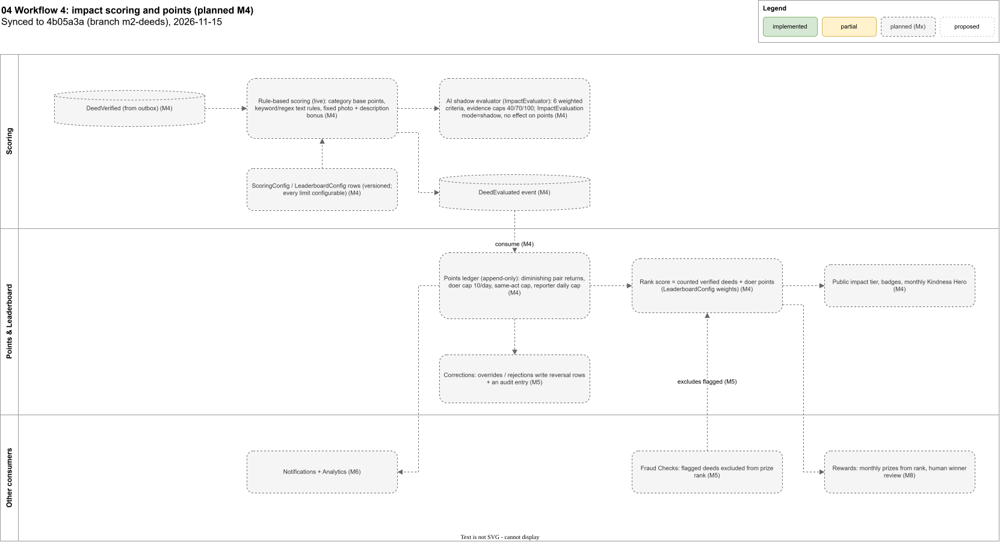
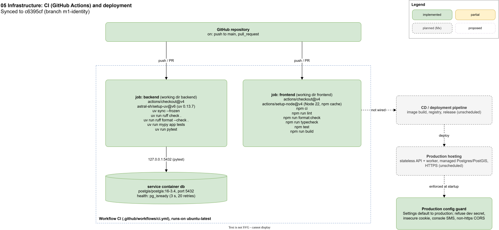

# Good Deeds architecture diagrams

**Synced to commit `4b05a3a` (`m2-deeds`) on 2026-11-15.** The implemented baseline is M0 + M1 + the M2 backend. The M2 screens are not built yet (they wait for the product owner's Figma designs), so they are drawn as planned. M3–M8 are not built.

These diagrams are drawn from the repository (code, migrations, `docker-compose.yml`, CI, PRD and ROADMAP), not from assumptions. Every shape stores its evidence: open a diagram, select a shape, and choose **Edit → Edit Data** to see its `status`, `milestone`, `source` (repo paths) and `note`.

## How to open

The `.drawio` files open in [app.diagrams.net](https://app.diagrams.net) (File → Open from → Device), in draw.io Desktop, or in VS Code with the "Draw.io Integration" extension. They are saved as uncompressed XML, so Git diffs are readable. Opening a `.drawio` file in a text editor or on GitHub shows that XML, not the picture. The images below are SVG exports in `img/`, one per page, made with draw.io Desktop. Re-export them whenever a `.drawio` file changes.

## Legend

| Status | Style | Meaning |
|---|---|---|
| IMPLEMENTED | solid border, green fill | Code on the branch, wired in (registered module, mounted route, migrated table, compose service, CI job). |
| PARTIAL | solid border, amber fill | Code exists but is disabled, unconfigured or dev-only. |
| PLANNED (Mx) | dashed border, grey fill | In ROADMAP or PRD, no code yet. Label ends with the milestone. |
| PROPOSED | dotted border, white fill | From a design the product owner hasn't approved yet (none at the moment: the M2 design is approved and built). |

## Diagrams

### 01 System context: [`01-system-context.drawio`](01-system-context.drawio)

Good Deeds as one system with its people and external services. M0 + M1 cover accounts, phone OTP, the age and consent gate, profiles and the rotating doer QR. M2 adds the deed reporting and verification API.
- **Witness / reporter** is now partial: the whole flow exists as API (scans, deeds, invites, edit, withdraw, self-logs), but no screen calls it yet.
- **Planned actors:**
  - viewers of the feed (M3)
  - admins and moderators (M5)
  - sponsors (M6/M8)
  - organisations (unscheduled; the PRD lists them as future only)
- **External services:** Google sign-in works once configured; Facebook sign-in and SMS are partial.
- **Planned external services:** storage, AI, email, CAPTCHA and WhatsApp sharing.

### 02 High-level architecture: [`02-high-level-architecture.drawio`](02-high-level-architecture.drawio)

- **Frontend:** the React SPA calls the FastAPI API through the Vite `/api` proxy. It holds a 15-minute access JWT in memory and refreshes it with a rotating httpOnly `gd_refresh` cookie scoped to `/api/auth`.
- **Backend:** the API (modules `identity` and `deeds`) and the Procrastinate worker share PostgreSQL 16 + PostGIS (20 application tables plus the job schema). M2 added `config_versions` in core and the seven `deeds` tables. Domain events go through a transactional outbox that the worker drains every 5 s. The worker also runs `deeds.expire_invites` (every 15 min) and `deeds.purge_unconsumed_scans` (daily).
- **Frontend (M2):** the deed screens are one planned box. Only their API client (`features/deeds/deedsApi.ts`) and `lib/geolocation.ts` exist.
- **Integrations:** Google sign-in is implemented when `GD_GOOGLE_CLIENT_ID` is set. Facebook is built but unconfigured, and SMS is console-only. Google and Facebook each appear twice: the browser-side SDK above the SPA, and the server-side token check to the right of the API.
- **Planned:** media storage (M3), AI evaluation (M4) and notifications (M6).

### 03 Backend modules: [`03-backend-modules.drawio`](03-backend-modules.drawio)
Three pages.

- **Core + identity:**
  - The `app/core` layer (config, runtime_config, db, events/outbox, jobs, audit, security, ratelimit, errors, sms, health) sits under the registered modules (`identity`, `deeds`).
  - M2 changes on this page:
    - `runtime_config`: append-only `config_versions`, `load()` and `publish()` (with audit).
    - `config` now holds deployment settings only; `db` gained `advisory_xact_lock`; `errors` gained `Gone` (410).
    - Identity's `_qr.py` is pure, reads the `qr` namespace and makes the 6-digit manual code. Identity's new `_limits.py` holds the OTP and auth rate limits (namespace `identity`, migration 0006).
    - Identity's public `service.py` gained `resolve_manual_code`, `phone_hashes`, `device_hash` and `public_summaries`, and lost `resolve_short_id`.
  - `identity` is shown with its routes, its public `service.py` surface, its events (`UserRegistered`, `PhoneVerified`), its nightly retention job and its 8 tables.
  - A note gives the module boundary rule and what `tests/test_architecture.py` actually checks.

- **Deeds module (M2), new page:**
  - `router.py` with every route, the public `service.py` (`get_deed`, `deeds_for_doer`, `same_act_group_view`; no caller outside deeds yet) and `jobs.py`.
  - The private files, the seven tables and the seven events.
  - What deeds uses from identity's `service.py` and from `app.core`.
  - A note repeats the lock-order and privacy rules from `CLAUDE.md`.

- **Module map (M1–M8):** every module from the PRD module table with its milestone, drawn as an event bus. Emitting modules sit above the Outbox bar and subscribing modules below it.
  - The two planned M2 boxes (Deed Submission, Verification) are now one implemented **Deeds & Verification** box (module `deeds`).
  - It emits `DeedSubmitted`, `DeedVerified`, `DeedRejected`, `DeedEdited`, `DeedWithdrawn`, `DeedPrizeRankChanged` and `DeedCountsForPointsChanged`; none has a subscriber yet. The proposed `DeedUnverified` is gone.
  - The Deeds → Identity arrow is a solid `service.py` call. Subscriber arrows follow the PRD table only.

### 04 Workflows: [`04-workflows.drawio`](04-workflows.drawio), seven pages
1. **1a Google sign-in** (implemented, sequence diagram):
   - `/auth/config` decides whether the button shows.
   - Google's popup returns an ID token, and `POST /auth/oauth/google` verifies it against Google's keys (audience, issuer, 30 s clock leeway).
   - An `alt` frame shows the three outcomes: the existing linked user, a 409 `email_exists` (never an automatic link), or a new user. Then the session starts with the refresh cookie.

   
2. **1b Onboarding gate and password sign-up** (implemented):
   - Password sign-up records age (18+) and consent in the same request; Google users do the age and consent step instead.
   - Both paths then verify an Indian mobile by OTP through the dev-only console SMS provider. That writes `phone_history` and unlocks My QR.

   
3. **2 QR identity and scanning** (backend implemented, screens planned):
   - **Implemented:**
     - The signed token per 30 s window and the 6-digit manual code, both read from the `qr` config namespace (1 grace window, so 30–60 s). My QR and Reset my QR.
     - `resolve_qr_token` and `resolve_manual_code`.
     - `POST /api/scans`: account + IP rate limits (plus per target for typed codes), the self and shared-phone checks, and the plausibility checks. Single-use `qr_scans` rows.
     - The nightly `deeds.purge_unconsumed_scans` job.
   - **Partial:** `/scan/:token` is still the M1 placeholder; `deedsApi.ts` and `geolocation.ts` exist but no screen calls them.
   - **Planned M2:** showing the manual code on My QR (F2) and the "Enter ID and code" form (F3).

   
4. **3 Deed reporting and verification** (backend implemented, screens planned):
   - **QR path:** `POST /api/deeds` consumes the scan once within 15 min. Same-act grouping (200 m / 2 h, cap 5, one counted report per reporter) runs under the per-doer advisory lock. The deed is verified at once, then invite deeds in the group get the prize-rank upgrade.
   - **Invite path:**
     - Create: 5 per day, `occurred_at` up to 7 days back, optional location, token stored hashed.
     - Preview, then accept: not your own invite, no shared phone, a shared device at most 15 times a month per pair. Existing members can accept.
     - `deeds.expire_invites` runs every 15 min and emits `DeedRejected(unverified, invite_expired)`.
   - The reporter, sharing and invite screens (F3–F5) are planned.

   
5. **3b Edit and withdraw** (new page; backend implemented, screens planned):
   - Edit writes a `deed_revisions` row and emits `DeedEdited` (field names only).
   - Withdraw locks the invite row, then `same_act`, then the deed.
     - A pending deed's invite is cancelled.
     - A verified deed leaves its group. If it counted, the oldest eligible uncounted report is promoted (`DeedCountsForPointsChanged`, audited). If fewer than 2 distinct reporters remain, invite deeds lose prize-rank eligibility (`DeedPrizeRankChanged`, audited).
   - Later consumers (Feed M3, Scoring M4) are planned.

   
6. **4 Impact scoring** (M4, planned):
   - Rule-based points with a shadow AI evaluator that never affects points.
   - An append-only ledger with caps, plus rank score, tier and badges.

   
7. **5 Feed publishing** (M3, planned):
   - Presigned media upload and a face-blur job.
   - Posts from deed events, with pending posts hiding the doer.
   - Nearby / Following / Top tabs, social actions, and M8 ad slots.

   

### 05 Infrastructure and deployment: [`05-infrastructure-deployment.drawio`](05-infrastructure-deployment.drawio), two pages

Unchanged in M2: `docker-compose.yml`, CI and the Dockerfiles have not changed since `c6395cf`, so these pages still say "Synced to c6395cf".
- **Local Docker Compose:** `db` (PostGIS, with a health check and the `db-data` volume), a one-shot `migrate`, then `api` and `worker` (both built from `./backend`) and `web` (the Vite dev server). The root `.env` supplies `GD_GOOGLE_CLIENT_ID` only. Each service's `depends_on` condition is written in its label rather than drawn as an arrow.

  
- **CI and deployment:** GitHub Actions runs on pushes to `main` and on pull requests, with a backend job (ruff, mypy, pytest against PostGIS) and a frontend job (lint, format, typecheck, test, build). No deployment config exists, so CD and production hosting are planned, unscheduled.

  

## Discrepancies found while drawing

First found on 2026-11-12 and re-checked on 2026-11-15 against `4b05a3a`. These are inconsistencies between code, PRD, ROADMAP and `CLAUDE.md`; none were fixed as part of the diagram work. The numbers stay the same between updates.

1. **Facebook can't be enabled under Docker.** Compose forwards only `GD_GOOGLE_CLIENT_ID`; the Facebook settings and `GD_SMS_PROVIDER` never reach the containers. ROADMAP marks Facebook in M1 as done. *Still open.*
2. **The audit log is never written.** *Partly resolved in M2* (see [M2-DESIGN §0](../M2-DESIGN.md#0-decisions-on-known-discrepancies)):
   - `audit_log` is now written by `runtime_config.publish` (every config version), and by the deeds module for prize-rank grants and revokes and for promotions after a withdrawal (`deeds/_grouping.py`).
   - Deed status changes go to the append-only `verification_events` table instead.
   - *Still open:* identity actions (QR reset, phone verification, revoke-all sessions) are not audited. M2-DESIGN §8 lists them as out of M2 scope.
3. **Scanning a QR today goes nowhere.** *Resolved in the backend by M2* (see [M2-DESIGN §0](../M2-DESIGN.md#0-decisions-on-known-discrepancies)): `POST /api/scans` calls `resolve_qr_token` and the new `resolve_manual_code`, and `resolve_short_id` was removed. *Still open in the frontend:* `/scan/:token` is still the M1 placeholder until task F3, which waits for the Figma designs.
4. **QR tokens are accepted for up to about 90 s.** *Resolved by M2* (see [M2-DESIGN §0](../M2-DESIGN.md#0-decisions-on-known-discrepancies)): the window and grace moved from env settings to the `qr` config namespace, seeded as `window_seconds=30` and `grace_windows=1` (migration 0004). A token or manual code is now accepted for 30–60 s.
5. **The architecture test is weaker than `CLAUDE.md` says.** It checks only absolute imports, so relative imports get past it. It also cannot enforce "side effects only through events". *Still open* (`tests/test_architecture.py` is unchanged).
6. **Event names disagree.** *Resolved by M2* (see [M2-DESIGN §0 and §4](../M2-DESIGN.md#4-events-backendappmodulesdeedseventspy)):
   - The code, PRD §11 and ROADMAP M2 now list the same seven deeds events: `DeedSubmitted`, `DeedVerified`, `DeedRejected`, `DeedEdited`, `DeedWithdrawn`, `DeedPrizeRankChanged` and `DeedCountsForPointsChanged`.
   - The proposed `DeedUnverified` was dropped. Invite expiry is `DeedRejected(new_status="unverified", reason="invite_expired")`.
   - PRD §11 now says Identity emits `UserRegistered` and `PhoneVerified`. None of these events has a subscriber yet.
7. **Self-logs are placed in different modules.** *Resolved by M2* (see [M2-DESIGN §0, D3 and D4](../M2-DESIGN.md#01-product-owner-decisions-2026-11-15)): self-logs live in the `deeds` module, and PRD §11 now puts them under "Deeds & Verification".
8. **Object storage:** PRD §14 says MinIO locally, but `CLAUDE.md` says the MinIO image is gone and a replacement will be chosen in M3. *Still open.*
9. **No deployment path.** *Still open.*
   - Compose runs dev servers (`uvicorn --reload`, Vite).
   - CI builds no images.
   - ROADMAP has no deployment milestone.
10. **Feature branches aren't CI-checked** until a pull request is opened, because CI runs only on `main` and on PRs. *Still open.*
11. **The PRD places AuditLog in M5** (Review & Audit), but `audit_log` has existed in core since M0 and has been written since M2. *Still open.*
12. **Organisations** appear only as future work in the PRD and not in the ROADMAP. *Still open.*
13. **(New) Later subscribers of the M2 events appear only in the design.** M2-DESIGN §4 says Scoring (M4) will consume `DeedWithdrawn`, `DeedPrizeRankChanged`, `DeedCountsForPointsChanged` and `DeedEdited`, and Feed (M3) will consume `DeedEdited` and `DeedWithdrawn`. PRD §11's "consumes" column still lists only `DeedVerified` for Scoring and `DeedSubmitted, DeedVerified` for Feed. The module map follows the PRD; workflow 3b shows the design's later consumers as planned.
14. **(New) ROADMAP M2 says invite acceptance means "sign up through the link".** D9 and PRD §5 let existing members accept too, and the code allows it.
15. **(New) Naming only:** PRD §11 calls the module "Deeds & Verification"; the code module is `deeds`. The diagrams show both names.

## Keeping this up to date

After each milestone's security review, the `architecture-diagram` agent compares the code against the synced commit above with `git diff`. It updates only the affected diagrams, promotes statuses as code lands, re-checks every shape's `source` path, renders every page to check the layout visually, re-exports the SVGs, and updates the synced commit. The watch table and the validation script are in the agent definition (`.claude/agents/architecture-diagram.md`).
