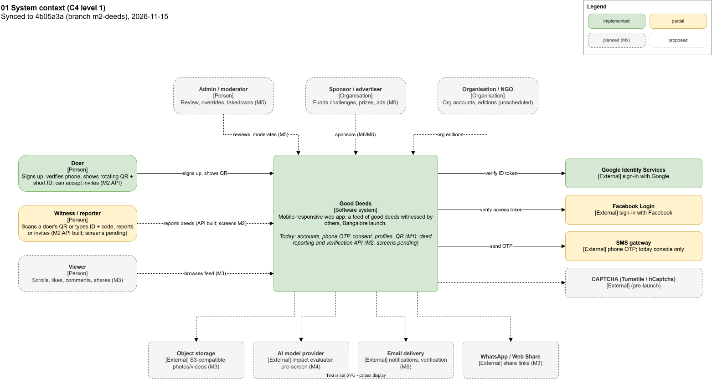
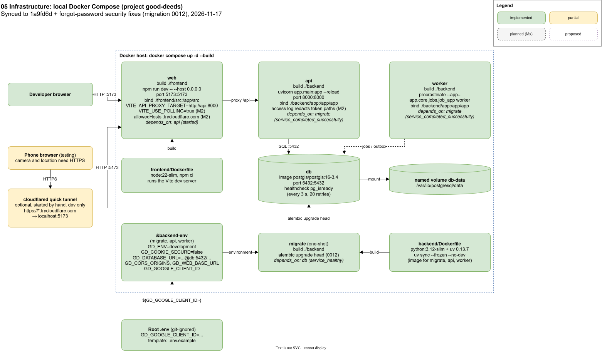

# Good Deeds architecture diagrams

**Synced to commit `1a9fd6d` (`m2-deeds`) plus the forgot-password security fixes (migration 0012) that are committed with these diagrams, on 2026-11-17.** Pages touched by those fixes (02, 03 core + identity, 04 1b and 1c, 05 local compose) say so in their titles; the other changed pages say "Synced to 1a9fd6d". The implemented baseline is M0 + M1 + M2, backend and screens: My QR (F2), Record a deed (F3), My deeds, self-logs and profile counts (F6), and forgot password. M3–M8 are not built.

What AD2 changed since `4b05a3a`:
- **Monthly limits (D19):** 15 reports per reporter–doer pair and 150 per reporter per IST month (`deeds` config v3, migration 0008). They're pre-checked at scan time and checked again under the `reporter_month` lock before the scan is consumed.
- **Same-act grouping uses server time (D28):** `qr_scans.scanned_at` for QR deeds and `deeds.reported_at` for invite deeds. `occurred_at` is for display only.
- **Invites are built but switched off** by config (D17, migration 0007), so the invite backend is drawn as partial and the invite screens as unscheduled (D26).
- **Security fixes:**
  - the access-log token redaction filter (`app/core/log_redaction.py`)
  - a daily per-target limit on typed codes (`rate_manual_target_daily`, migration 0009)
  - suspended reporters' invites return 404
  - the frontend moves the QR token out of the URL
- **Forgot password:** two endpoints, with `phone_otps.purpose` added by migration 0011. Migration 0012 adds the security-review fixes: a separate reset SMS budget charged only when a code is sent, and daily per-phone limits. A new sequence diagram (workflow 1c) shows the flow.
- **Dev infrastructure:** Vite polling in Docker, and an optional cloudflared tunnel for testing on a phone.

These diagrams are drawn from the repository (code, migrations, `docker-compose.yml`, CI, PRD and ROADMAP), not from assumptions. Every shape stores its evidence: open a diagram, select a shape, and choose **Edit → Edit Data** to see its `status`, `milestone`, `source` (repo paths) and `details`.

## How to open

The `.drawio` files open in [app.diagrams.net](https://app.diagrams.net) (File → Open from → Device), in draw.io Desktop, or in VS Code with the "Draw.io Integration" extension. They are saved as uncompressed XML, so Git diffs are readable. Opening a `.drawio` file in a text editor or on GitHub shows that XML, not the picture. The images below are SVG exports in `img/`, one per page, made with draw.io Desktop. Re-export them whenever a `.drawio` file changes.

## Legend

| Status | Style | Meaning |
|---|---|---|
| IMPLEMENTED | solid border, green fill | Code on the branch, wired in (registered module, mounted route, migrated table, compose service, CI job). |
| PARTIAL | solid border, amber fill | Code exists but is disabled, unconfigured or dev-only. |
| PLANNED (Mx) | dashed border, grey fill | In ROADMAP or PRD, no code yet. Label ends with the milestone. |
| PROPOSED | dotted border, white fill | From a design the product owner hasn't approved yet (none at the moment: the M2 design is approved and built). |

## Diagrams

### 01 System context: [`01-system-context.drawio`](01-system-context.drawio)

Good Deeds as one system with its people and external services. M1 covers accounts, phone OTP, the age and consent gate, profiles and the rotating doer QR. M2 adds password reset by SMS code and recording, verifying, editing and withdrawing deeds, with screens.
- **Witness / reporter** is now implemented: they scan a QR or type ID + code, record the deed, then edit or withdraw it (screens F3 and F6).
- **Doer:** shows the QR, ID and 6-digit code, and sees only verified deeds about them (D24).
- **External services:** Google sign-in works once configured. Facebook sign-in and SMS are partial; SMS carries both phone-verification and password-reset codes, to the console only.
- **Planned actors:**
  - viewers of the feed (M3)
  - admins and moderators (M5)
  - sponsors (M6/M8)
  - organisations (unscheduled; the PRD lists them as future only)
- **Planned external services:** storage, AI, email, CAPTCHA and WhatsApp sharing.

### 02 High-level architecture: [`02-high-level-architecture.drawio`](02-high-level-architecture.drawio)

- **Frontend:** the React SPA calls the FastAPI API through the Vite `/api` proxy. It holds a 15-minute access JWT in memory and refreshes it with a rotating httpOnly `gd_refresh` cookie scoped to `/api/auth`.
  - The **M2 screens** box is now implemented: My QR, Record a deed (hub, camera scan, ID + code, deed form, result), My deeds (detail, edit, withdraw), self-logs, profile counts and forgot password.
  - Invite screens (D26) and photos (D23) are not part of M2.
  - `/scan/:token` keeps the token in memory and replaces the URL with `/report/link`.
- **Backend:** the API (modules `identity` and `deeds`) and the Procrastinate worker share PostgreSQL 16 + PostGIS (20 application tables plus the job schema).
  - The API now lists `/api/auth/password/forgot` and `/reset`, and marks the invite routes as switched off.
  - Token paths are redacted from the access log.
  - The database box cites migrations 0007–0012: `deeds` config v4, `phone_otps.purpose`, and `identity` config v3 (reset SMS budget and daily per-phone limits).
  - The worker runs `deeds.expire_invites` (every 15 min) and `deeds.purge_unconsumed_scans` (daily).
- **Integrations:** Google sign-in is implemented when `GD_GOOGLE_CLIENT_ID` is set. Facebook is built but unconfigured. SMS is console-only and now sends both OTPs and reset codes.
- **Planned:** media storage (M3), AI evaluation (M4) and notifications (M6).

### 03 Backend modules: [`03-backend-modules.drawio`](03-backend-modules.drawio)
Three pages.

- **Core + identity:**
  - The `app/core` layer (config, runtime_config, db, events/outbox, jobs, audit, security, ratelimit, errors, sms, health, **log_redaction**) sits under the registered modules (`identity`, `deeds`).
  - **Core changes since AD1:**
    - `log_redaction` is installed by `create_app()`.
    - `errors`: `AppError.extra` adds body fields (D27).
    - `db` stays READ COMMITTED on purpose, so locked monthly counts see the previous lock holder's rows.
    - `audit` is now also written by the identity password reset.
  - **Identity changes since AD1:**
    - `router.py` has the two password routes.
    - `service.py` gained `is_active`, which deeds uses, and backs the router with `request_password_reset` and `reset_password`.
    - `phone_otps` has a `purpose` column.
    - `_limits.py` (`identity` v3) has the forgot and reset rate limits, hourly and daily per phone, and the `sms:reset_global` budget (migrations 0011, 0012).
    - Refresh: replaying a token ended by revoke-all, or one from an older `token_version`, gets 401 `session_expired` without revoking again; reusing a rotated token still revokes all.
  - A note gives the module boundary rule and what `tests/test_architecture.py` actually checks.

- **Deeds module (M2):**
  - **Routers and private files:**
    - `router.py` lists every route, with the invite routes marked as switched off.
    - New private file `_reporter_limit.py`: the `reporter_month` lock and the 150 / 15 monthly limits, plus unlocked pre-checks at scan time.
    - `_invites.py` is drawn partial (switched off by config).
    - `_scans.py` gains the daily per-target limit and the monthly pre-checks; `_qr_deeds.py` and `_grouping.py` group by server time (D28).
    - `_reads.py` shows the doer verified deeds only (D24).
    - `_limits.py` is at `deeds` v4.
  - **Tables and imports:**
    - The tables note the `ix_deeds_doer_counted` index (D15).
    - The identity `service.py` box adds `is_active`; `core.db` adds the `reporter_month` lock key.
  - The rules note lists all four lock orders from `CLAUDE.md`.

- **Module map (M1–M8):** unchanged since AD1, so its title still says "Synced to 4b05a3a". Every module from the PRD module table is shown with its milestone, drawn as an event bus. The deeds events still have no subscriber.

### 04 Workflows: [`04-workflows.drawio`](04-workflows.drawio), eight pages
1. **1a Google sign-in** (implemented, sequence diagram; unchanged since AD1):
   - `/auth/config` decides whether the button shows.
   - Google's popup returns an ID token, and `POST /auth/oauth/google` verifies it against Google's keys (audience, issuer, 30 s clock leeway).
   - An `alt` frame shows the three outcomes: the existing linked user, a 409 `email_exists` (never an automatic link), or a new user. Then the session starts with the refresh cookie.

   
2. **1b Onboarding gate and password sign-up** (implemented):
   - Password sign-up records age (18+) and consent in the same request; Google users do the age and consent step instead.
   - Both paths then verify an Indian mobile by OTP through the dev-only console SMS provider. That writes `phone_history` and unlocks My QR.
   - Phone verification accepts only codes whose purpose is `phone_verify`, and `phone/start`'s hourly caps count only those codes. A note points to page 1c.

   
3. **1c Forgot password** (new page; implemented, sequence diagram):
   - **Request a code:** `/login` → `/forgot-password` → `POST /api/auth/password/forgot`.
     - Rate limits per IP (10/h) and per phone hash (5/h and 10/day).
     - `request_password_reset` issues a code only for an active account with a verified phone and a password, under the hourly cap and resend wait. It retires older codes and stores the new one with purpose `password_reset`.
     - The response is always `{sent: true, resend_after_seconds}`. The SMS goes out as a background task after the response, which first charges `sms:reset_global` (200/h) and quietly skips the SMS when that budget is spent, so the reply never reveals whether an account exists.
   - **Reset:** `POST /api/auth/password/reset` (per IP 20/h; per phone 10/h and 15/day) locks the latest live code and counts the attempt.
     - Every failure is the same 400 `otp_incorrect`.
     - On success it sets the new argon2 hash, revokes all refresh tokens, bumps `token_version` and writes `audit_log` (`user.password_reset`).
     - No session is issued; the user signs in again. Replaying an old refresh token from another device gets 401 `session_expired` without ending the new session.

   
4. **2 QR identity and scanning** (implemented):
   - **My QR (F2):** the QR, the ID, the 6-digit code and a countdown bar sized by `window_seconds`.
   - **Witness paths:** the phone camera opens `/scan/:token`, which moves the token into memory and replaces the URL with `/report/link`. The in-app camera is `/report/scan`, and typed ID + code is `/report/code`.
   - **`POST /api/scans` order:**
     1. Rate limits, including 20 per 15 min and 60 per day per typed ID.
     2. The monthly-total pre-check.
     3. Resolve the code.
     4. Self and shared-phone checks.
     5. Pair checks: 409 `already_recognized_today` or 429 `pair_monthly_limit`, both naming the doer (D27).
     6. Plausibility.
     7. Response: `scanned_at`, `pair_reports_remaining` and `month_resets_at`.
   - A box shows the access-log redaction of `/scan/{token}`.

   
5. **3 Deed reporting and verification** (QR path implemented; invite path partial):
   - **Reporter screens:** the hub's LimitBanner, the deed form and the result screen are implemented.
   - **QR path:** `POST /api/deeds` reads the scan's doer without a lock, then takes `reporter_month` and checks the total (150) and the pair (15) before consuming the scan. Grouping uses the scan's `scanned_at` (D28).
   - **Invite path:** built but switched off by config (403 `invites_disabled`), so it is drawn partial.
     - Create checks only the total.
     - Accept takes `reporter_month` → invite row → `shared_device` → pending deed → `same_act`. A suspended reporter gets 404 `invite_invalid`, and the pair limit applies in the month of `reported_at`.
     - Grouping uses `reported_at`.
     - The invite screens (F4, F5) are unscheduled (D26). The expiry job still runs.

   
6. **3b Edit and withdraw** (implemented):
   - **My deeds (F6):** Reported / Recognised tabs, `DeedDetailPage`, `EditDeedPage` and `WithdrawDeedDialog` call the edit and withdraw endpoints.
   - **Edit:** writes a `deed_revisions` row and emits `DeedEdited`.
   - **Withdraw:** locks the invite row → `same_act` → deed row.
     - A pending deed cancels its invite. A verified deed leaves its group, with promotion and prize-rank revocation.
     - The deed still counts toward the monthly limits.
   - **The doer's view (D24):** a withdrawn report disappears; the reporter still sees it as Withdrawn.
   - Later consumers (Feed M3, Scoring M4) are planned.

   
7. **4 Impact scoring** (M4, planned; unchanged):
   - Rule-based points with a shadow AI evaluator that never affects points.
   - An append-only ledger with caps, plus rank score, tier and badges.

   
8. **5 Feed publishing** (M3, planned; unchanged):
   - Presigned media upload and a face-blur job.
   - Posts from deed events, with pending posts hiding the doer.
   - Nearby / Following / Top tabs, social actions, and M8 ad slots.

   

### 05 Infrastructure and deployment: [`05-infrastructure-deployment.drawio`](05-infrastructure-deployment.drawio), two pages

- **Local Docker Compose** (synced to `1a9fd6d`):
  - **Services:** `db` (PostGIS, with a health check and the `db-data` volume), a one-shot `migrate` (head 0012), then `api` and `worker` (both built from `./backend`) and `web` (the Vite dev server).
  - **web:** now sets `VITE_USE_POLLING=true`, because Docker on Windows doesn't forward file events. Vite allows `.trycloudflare.com` hosts.
  - **api:** redacts token paths in its access log.
  - **Phone testing (partial, dev only, outside compose):** a phone browser reaches the dev server through an optional, hand-started cloudflared quick tunnel. Camera and location need HTTPS.
  - The root `.env` supplies `GD_GOOGLE_CLIENT_ID` only. Each service's `depends_on` condition is written in its label rather than drawn as an arrow.

  
- **CI and deployment:** unchanged; CI and the Dockerfiles haven't changed since `c6395cf`, so this page still says "Synced to c6395cf".
  - GitHub Actions runs on pushes to `main` and on pull requests.
  - A backend job runs ruff, mypy and pytest against PostGIS. A frontend job runs lint, format, typecheck, test and build.
  - No deployment config exists, so CD and production hosting are planned, unscheduled.

  

## Discrepancies found while drawing

First found on 2026-11-12; re-checked on 2026-11-15 against `4b05a3a` and on 2026-11-17 against `1a9fd6d`. These are inconsistencies between code, PRD, ROADMAP and `CLAUDE.md`; none were fixed as part of the diagram work. The numbers stay the same between updates.

1. **Facebook can't be enabled under Docker.** Compose forwards only `GD_GOOGLE_CLIENT_ID`; the Facebook settings and `GD_SMS_PROVIDER` never reach the containers. ROADMAP marks Facebook in M1 as done. *Still open.*
2. **The audit log is never written.** *Mostly resolved* (see [M2-DESIGN §0](../M2-DESIGN.md#0-decisions-on-known-discrepancies)):
   - `audit_log` is written by `runtime_config.publish`, by the deeds module (prize-rank grants and revokes, promotions after a withdrawal) and, since `1a9fd6d`, by the identity password reset (`user.password_reset`).
   - Deed status changes go to the append-only `verification_events` table instead.
   - *Still open:* QR reset, phone verification and revoke-all sessions are not audited.
3. **Scanning a QR today goes nowhere.** *Resolved:* `POST /api/scans` resolves tokens and codes (M2 backend). Since `1a9fd6d`, `/scan/:token` is `ScanLandingPage`, which moves the token into memory and continues the report flow. The M1 placeholder `features/scan/ScanPage.tsx` was deleted.
4. **QR tokens are accepted for up to about 90 s.** *Resolved by M2* (see [M2-DESIGN §0](../M2-DESIGN.md#0-decisions-on-known-discrepancies)): the window and grace moved from env settings to the `qr` config namespace, seeded as `window_seconds=30` and `grace_windows=1` (migration 0004). A token or manual code is now accepted for 30–60 s.
5. **The architecture test is weaker than `CLAUDE.md` says.** It checks only absolute imports, so relative imports get past it. It also cannot enforce "side effects only through events". *Still open* (`tests/test_architecture.py` is unchanged).
6. **Event names disagree.** *Resolved by M2* (see [M2-DESIGN §0 and §4](../M2-DESIGN.md#4-events-backendappmodulesdeedseventspy)):
   - The code, PRD §11 and ROADMAP M2 now list the same seven deeds events: `DeedSubmitted`, `DeedVerified`, `DeedRejected`, `DeedEdited`, `DeedWithdrawn`, `DeedPrizeRankChanged` and `DeedCountsForPointsChanged`.
   - The proposed `DeedUnverified` was dropped. Invite expiry is `DeedRejected(new_status="unverified", reason="invite_expired")`.
   - PRD §11 now says Identity emits `UserRegistered` and `PhoneVerified`. None of these events has a subscriber yet.
7. **Self-logs are placed in different modules.** *Resolved by M2* (see [M2-DESIGN §0, D3 and D4](../M2-DESIGN.md#01-product-owner-decisions-2026-11-15)): self-logs live in the `deeds` module, and PRD §11 now puts them under "Deeds & Verification".
8. **Object storage:** PRD §14 says MinIO locally, but `CLAUDE.md` says the MinIO image is gone and a replacement will be chosen in M3. *Still open.*
9. **No deployment path.** *Still open.*
   - Compose runs dev servers (`uvicorn --reload`, Vite).
   - CI builds no images.
   - ROADMAP has no deployment milestone.
10. **Feature branches aren't CI-checked** until a pull request is opened, because CI runs only on `main` and on PRs. *Still open.*
11. **The PRD places AuditLog in M5** (Review & Audit), but `audit_log` has existed in core since M0 and has been written since M2. *Still open.*
12. **Organisations** appear only as future work in the PRD and not in the ROADMAP. *Still open.*
13. **Later subscribers of the M2 events appear only in the design.** M2-DESIGN §4 says Scoring (M4) will consume `DeedWithdrawn`, `DeedPrizeRankChanged`, `DeedCountsForPointsChanged` and `DeedEdited`, and Feed (M3) will consume `DeedEdited` and `DeedWithdrawn`. PRD §11's "consumes" column still lists only `DeedVerified` for Scoring and `DeedSubmitted, DeedVerified` for Feed. The module map follows the PRD; workflow 3b shows the design's later consumers as planned. *Still open.*
14. **ROADMAP M2 says invite acceptance means "sign up through the link".** D9 and PRD §5 let existing members accept too, and the code allows it. Invites are now switched off and have no screens (D17, D26). *Still open.*
15. **Naming only:** PRD §11 calls the module "Deeds & Verification"; the code module is `deeds`. The diagrams show both names. *Still open.*
16. **(New) Forgot password is only in the ROADMAP.** ROADMAP M2 lists it (PO decision 2026-11-17) and the code is built (migrations 0011 and 0012, `/api/auth/password/*`), but neither `docs/PRD.md` nor `docs/M2-DESIGN.md` describes it.
17. **(New) `CLAUDE.md` misses parts of identity.** It doesn't mention the password reset, `phone_otps.purpose` or the forgot/reset rate limits. Its list of identity `service.py` functions used by other modules omits `is_active`, which deeds calls on invite accept.
18. **(New) M2-DESIGN's status line** still says Revision 5 is "for PO review", although Revision 5 is built and pushed in `1a9fd6d`.
19. **(New, naming only) Migration numbering skips 0010:** `0011_identity_password_reset` revises `0009`. Alembic is fine with this; it's noted so nobody looks for a missing file.

## Keeping this up to date

After each milestone's security review, the `architecture-diagram` agent compares the code against the synced commit above with `git diff`. It updates only the affected diagrams, promotes statuses as code lands, re-checks every shape's `source` path, renders every page to check the layout visually, re-exports the SVGs, and updates the synced commit. The watch table and the validation script are in the agent definition (`.claude/agents/architecture-diagram.md`).
